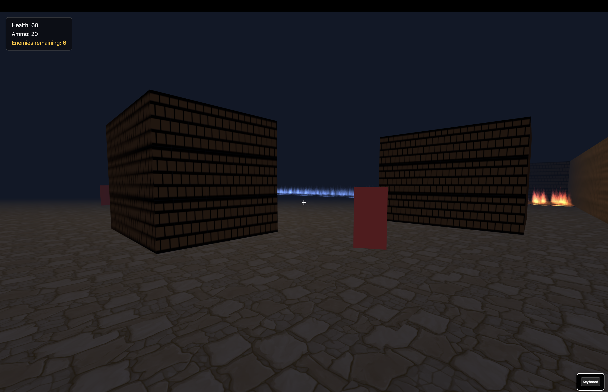
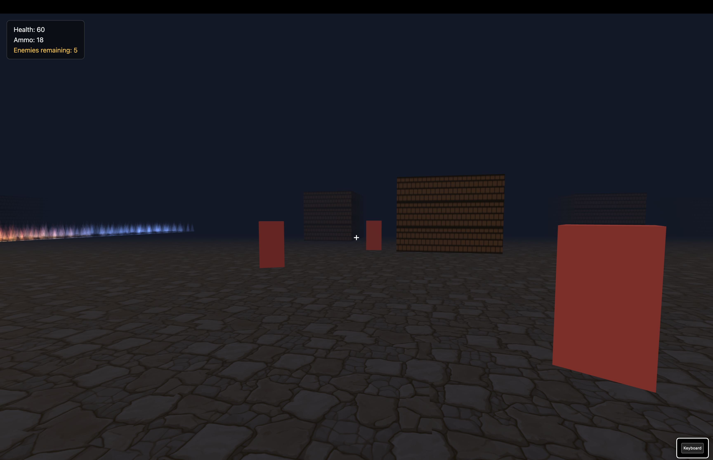

# Retro Shooter 3D

Минималистичный 3D шутер в стиле ретро-арены, созданный на TypeScript и Three.js. Игрок перемещается по уровню от первого лица, уничтожает врагов, собирает боеприпасы и пытается выбраться из опасной зоны.

## Обзор проекта

Это компактная браузерная игра-прототип с:

- 3D-перемещением от первого лица
- боефой в пространстве арены
- врагами и боезапасом
- лавовыми и огненными зонами
- системой победы и поражения
- простым, легко редактируемым уровнем

## Ключевые особенности

- Быстрое управление и понятный геймплей
- Первая камера и обзор мышью
- Враги, которые атакуют в ближнем бою
- Подбор патронов и здоровье/боезапас в игре
- Открытый уровень с опасными зонами и пространством для экспериментов
- Лёгкий запуск в браузере через Vite

## Управление

- `W`, `A`, `S`, `D` — перемещение
- `Мышь` — поворот камеры
- `ЛКМ` — стрельба
- `Esc` — выход из режима захвата мыши

## Технологии

- TypeScript
- Three.js
- Vite

## Скриншоты





## Как запустить

1. Установите зависимости:

   ```bash
   npm install
   ```

2. Запустите проект локально:

   ```bash
   npm run dev
   ```

3. Откройте адрес, который покажет Vite в терминале.

## Сборка

```bash
npm run build
```

## Структура проекта

```text
src/
  game/
    game.ts
    level.ts
    map.ts
    fire.ts
    player.ts
    enemies.ts
    pickups.ts
    hud.ts
    input.ts
    palette.ts
    types.ts
  main.ts
  style.css
```

## Планы развития

Проект можно расширять в нескольких направлениях:

- добавление новых типов врагов
- улучшение ИИ и поведения противников
- добавление звуков и музыки
- больше уровней и вариаций карт
- улучшение визуального стиля и эффектов
- доработка геймплея и баланса

## Примечание

Это проект-прототип, ориентированный на быструю итерацию и проверку игрового ощущения. Карта и опасные зоны легко редактируются, поэтому уровень удобно настраивать под новые идеи.

## Лицензия

Проект предназначен для личного использования, экспериментов и прототипирования.
